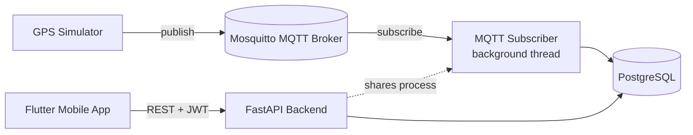
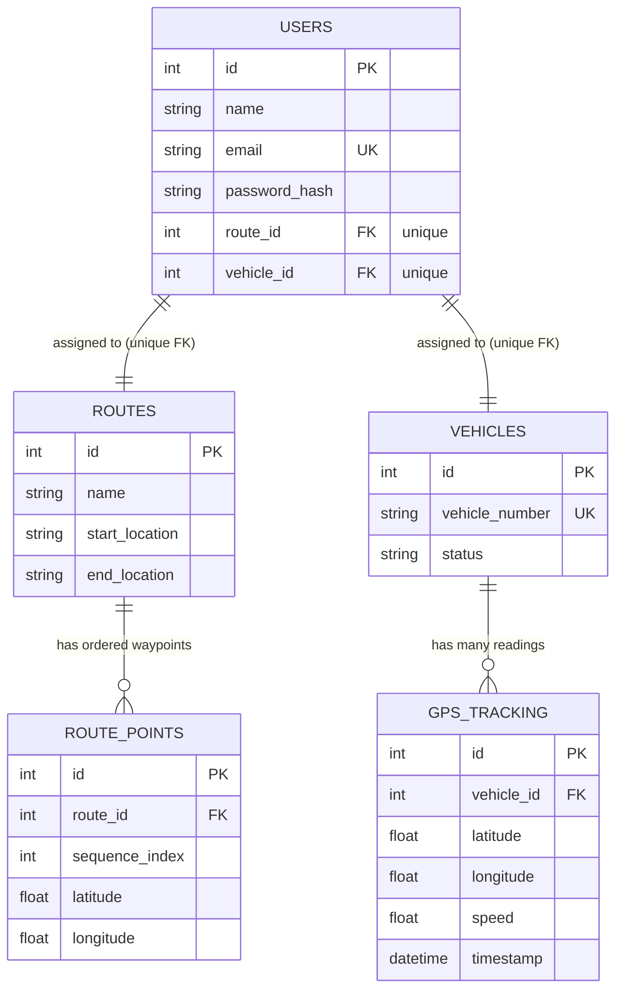

# GPS Vehicle Tracking Backend

## Overview

A FastAPI backend for a GPS-based bus/vehicle tracking system. Each user is assigned
exactly one route and one vehicle; after logging in, a user can only ever see their
own route, their own vehicle, and that vehicle's GPS history — enforced by the
backend, not the client. GPS readings are ingested from an MQTT broker (published
by a simulator or real hardware) and stored in PostgreSQL for both live and
historical queries.

## Features

- JWT authentication (bcrypt-hashed passwords, no plaintext storage)
- Per-user authorization scoped entirely server-side (`/me/...` endpoints — no
  client-suppliable vehicle/route id exists anywhere in the API)
- MQTT-based GPS ingestion with payload validation, unknown-vehicle rejection, and
  automatic reconnect
- GPS simulator that moves two buses along real Chennai road waypoints
- Server-derived live vehicle status (`moving` / `stopped` / `offline`)
- Alembic migrations, Dockerized Postgres + Mosquitto + API
- Automated test suite covering auth, scoped data access, and cross-user isolation

## Architecture



The MQTT subscriber runs inside the FastAPI process as a background thread
(`paho-mqtt`'s own network loop via `loop_start`), not on the asyncio event loop —
so a slow broker or DB write never blocks HTTP requests. Each MQTT message gets its
own short-lived SQLAlchemy session. This keeps the assessment simple (one process,
one deployable) while still being properly decoupled; a production system at scale
would likely run the subscriber as a separate worker process/service.

## Technology Stack

| Layer | Choice |
|---|---|
| API framework | FastAPI |
| ORM | SQLAlchemy 2.x (sync) |
| Validation | Pydantic v2 |
| Database | PostgreSQL 16 |
| Migrations | Alembic |
| Auth | JWT (python-jose) + bcrypt (passlib) |
| MQTT | paho-mqtt v2, Eclipse Mosquitto |
| Tests | pytest + FastAPI TestClient (SQLite, isolated per test) |
| Containerization | Docker / Docker Compose |

## Project Structure

```
backend/
├── app/
│   ├── main.py                # FastAPI app, routers, lifespan (starts MQTT subscriber)
│   ├── core/
│   │   ├── config.py          # Pydantic Settings (env-driven)
│   │   ├── security.py        # password hashing, JWT create/decode
│   │   └── dependencies.py    # get_current_user()
│   ├── database/
│   │   ├── session.py         # engine, SessionLocal, get_db()
│   │   └── base.py            # Declarative Base + naming convention
│   ├── models/                # SQLAlchemy models: user, route, vehicle, gps
│   ├── schemas/                # Pydantic request/response schemas
│   ├── api/                    # Routers: auth, users, routes, vehicles, tracking
│   ├── services/                # auth_service, tracking_service, ingest_service
│   └── mqtt/subscriber.py      # MqttSubscriber (background thread)
├── alembic/                    # Migrations
├── tests/                      # pytest suite (auth, scoping, authorization)
├── scripts/
│   ├── route_data.py           # Shared route/vehicle fixtures (seed + simulator)
│   ├── seed.py                 # Creates User A/B + routes + vehicles
│   └── gps_simulator.py        # Publishes realistic GPS movement over MQTT
├── mosquitto/config/mosquitto.conf
├── requirements.txt
├── .env.example
├── Dockerfile
├── docker-entrypoint.sh        # Runs `alembic upgrade head` before starting uvicorn
└── docker-compose.yml
```

## Database Design



**Why `route_points` instead of a JSON polyline column?** A separate table lets
Postgres type- and order-enforce each waypoint (`sequence_index`), makes individual
points queryable/updatable without deserializing a blob, and keeps `routes` itself
small. The only cost is one extra join, which is negligible for a polyline of a few
dozen points.

**Enforcing "exactly one route/vehicle per user" at the DB level:** `users.route_id`
and `users.vehicle_id` are both `UNIQUE` foreign keys — the database itself rejects
assigning the same route or vehicle to two users, not just application code.

**Efficient location queries:** `gps_tracking` has a composite index on
`(vehicle_id, timestamp)`. The "latest location" query is
`ORDER BY timestamp DESC LIMIT 1` filtered by `vehicle_id`, and history queries add
an optional `timestamp BETWEEN ...` range — both hit the same index.

## Authentication

`POST /api/v1/auth/login` accepts `{email, password}` and returns a JWT
(`{access_token, token_type: "bearer"}`). Passwords are hashed with bcrypt via
passlib and never stored or returned in plaintext. Protected endpoints require
`Authorization: Bearer <token>`; `get_current_user()` decodes the token, loads the
user from PostgreSQL, and raises `401` if the token is missing, malformed, expired,
or references a user that no longer exists.

## Authorization

**Every data endpoint is scoped to the authenticated user — there is no endpoint
that accepts a client-supplied `vehicle_id` or `route_id`.** `/me`, `/me/route`,
`/me/vehicle`, `/me/vehicle/location`, and `/me/vehicle/history` all resolve
"which vehicle/route" purely from `current_user.route_id` /
`current_user.vehicle_id` on the server. This makes cross-user access structurally
impossible rather than something checked per-request — there is no ID for a client
to tamper with in the first place. `tests/test_authorization.py` proves User A can
never see BUS-002/Route B and vice versa, and that probing for a
vehicle-id-accepting endpoint never leaks another user's data.

## API Endpoints

| Method | Path | Auth | Description |
|---|---|---|---|
| POST | `/api/v1/auth/login` | — | Log in, get a JWT |
| GET | `/api/v1/me` | ✅ | Current user's profile |
| GET | `/api/v1/me/route` | ✅ | Assigned route + ordered waypoints |
| GET | `/api/v1/me/vehicle` | ✅ | Assigned vehicle + live status |
| GET | `/api/v1/me/vehicle/location` | ✅ | Latest GPS reading (404 if none yet) |
| GET | `/api/v1/me/vehicle/history` | ✅ | GPS history — `?limit=&from=&to=` |
| GET | `/health` | — | Liveness check |

Interactive Swagger docs: `http://localhost:8000/docs` (endpoints are grouped by
tag: `auth`, `me`, `tracking`).

## MQTT GPS Flow

1. A device (or the simulator) publishes JSON to `vehicles/{vehicle_id}/location`,
   e.g. `vehicles/BUS-001/location`.
2. `MqttSubscriber` (running in a background thread inside the API process)
   receives the message, parses JSON, and validates it against `GpsIngestPayload`
   (lat/lon range, non-negative speed, valid timestamp).
3. It looks up the vehicle by `vehicle_number`; unknown vehicles are logged and
   discarded (no invented vehicle is silently created).
4. A valid reading is written to `gps_tracking` and committed.
5. Malformed JSON, failed validation, and unknown vehicles are all logged as
   warnings and skipped — they never crash the subscriber or the API.
6. paho-mqtt's `reconnect_delay_set` gives automatic reconnect-with-backoff if the
   broker connection drops; the API stays up even if Mosquitto is temporarily
   unreachable.

## GPS Simulator

`scripts/gps_simulator.py` moves two buses along **real** waypoints (not random
coordinates):

- `BUS-001`: Chennai Central → Guindy
- `BUS-002`: Tambaram → Sholinganallur

Each route's sparse waypoints are linearly interpolated into a dense path so
movement looks continuous; the bus bounces back and forth along the route so the
demo runs indefinitely. Every 3–5 seconds it publishes a reading per vehicle, with
realistic cruising speed (28–45 km/h) and an occasional simulated stop (speed 0) so
you can see all three live statuses in the app.

## Docker Setup

```bash
docker compose up -d --build      # starts postgres, mosquitto, api
docker compose exec api python scripts/seed.py
```

The `api` service's entrypoint (`docker-entrypoint.sh`) runs `alembic upgrade head`
automatically before starting uvicorn, so a fresh clone with an empty Postgres
volume comes up with the correct schema with no manual migration step.

Services: `postgres` (16-alpine, healthchecked, persisted via a named volume),
`mosquitto` (Eclipse Mosquitto 2.0, config in `mosquitto/config/mosquitto.conf`),
`api` (this backend, waits on Postgres's healthcheck). No secrets are hardcoded in
`docker-compose.yml` — real values come from `.env` (see below).

## Local Setup (without Docker)

```bash
python -m venv .venv
./.venv/Scripts/activate            # Windows; use `source .venv/bin/activate` on macOS/Linux
pip install -r requirements.txt
cp .env.example .env                # then start Postgres + Mosquitto some other way (e.g. docker compose up -d postgres mosquitto)
alembic upgrade head
python scripts/seed.py
uvicorn app.main:app --reload
```

In another terminal: `python scripts/gps_simulator.py`.

## Environment Variables

See `.env.example`:

| Variable | Purpose |
|---|---|
| `DATABASE_URL` | SQLAlchemy connection string |
| `JWT_SECRET_KEY` | HMAC signing key for JWTs — **change in production** |
| `JWT_ALGORITHM` | JWT signing algorithm (default `HS256`) |
| `ACCESS_TOKEN_EXPIRE_MINUTES` | Token lifetime |
| `MQTT_HOST` / `MQTT_PORT` | Mosquitto broker address |
| `VEHICLE_MOVING_SPEED_THRESHOLD_KMH` | Speed above which a vehicle is "moving" |
| `VEHICLE_OFFLINE_AFTER_SECONDS` | How stale a reading must be to count as "offline" |

## Database Migration

Migrations are managed with Alembic (`alembic/versions/`). The URL is taken from
app settings (`DATABASE_URL`), not hardcoded in `alembic.ini`, so one source of
truth drives both the app and migrations.

```bash
alembic revision --autogenerate -m "describe change"
alembic upgrade head
```

## Seed Data

`python scripts/seed.py` creates two demo accounts (skips any that already exist):

| Email | Password | Route | Vehicle |
|---|---|---|---|
| usera@example.com | password123 | Route A (Chennai Central → Guindy) | BUS-001 |
| userb@example.com | password123 | Route B (Tambaram → Sholinganallur) | BUS-002 |

## Running Tests

```bash
pytest -q
```

Tests run against an isolated in-memory-style SQLite database (tables are dropped
and recreated per test) so they need no external services and stay fast and
deterministic. This is a deliberate tradeoff for test speed/isolation — the actual
app always runs against PostgreSQL. Covers: login success/failure, `/me` and
friends, latest/historical GPS, 401 for missing/invalid tokens, and — most
importantly — that User A and User B can never see each other's route, vehicle, or
GPS data (`tests/test_authorization.py`).

## Swagger Documentation

`http://localhost:8000/docs` (Swagger UI) and `/redoc` (ReDoc) are available once
the server is running.

## Example Accounts

See **Seed Data** above.

## Security

- Passwords are hashed with bcrypt (via passlib) — never stored or logged in
  plaintext.
- JWTs are signed with `JWT_SECRET_KEY`; no secret is committed (`.env` is
  gitignored, `.env.example` has placeholders only).
- Authorization is enforced server-side and structurally (no client-suppliable
  resource IDs), not left to the mobile client.
- A single catch-all exception handler in `main.py` prevents stack
  traces/internals from ever reaching the client on an unexpected error (500).
- Mosquitto currently allows anonymous connections for simplicity — see Future
  Improvements.

## Future Improvements

- MQTT authentication/TLS (currently anonymous, acceptable for a local
  demo/assessment only)
- Refresh tokens / token revocation list
- Rate limiting on `/auth/login`
- Move the MQTT subscriber into its own worker process for independent scaling
- WebSocket push for live location instead of client polling
